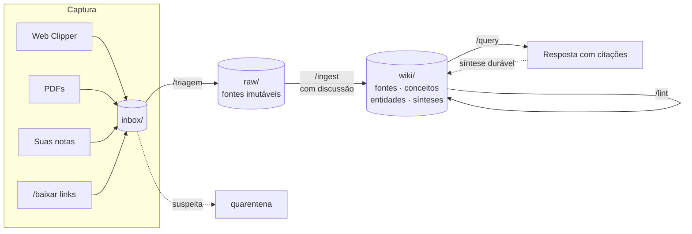

<div align="center">

# 🧠 Second Brain

**Um segundo cérebro mantido por IA, no seu computador, em Markdown.**

Obsidian + Claude Code + o padrão LLM Wiki de Andrej Karpathy

[](LICENSE)


[Por que](#por-que) · [Como funciona](#como-funciona) · [Início rápido](#início-rápido) · [Comandos](#comandos) · [Rotina](#rotina) · [Documentação](#documentação)

</div>

> **English summary.** A ready-to-use template for a personal, AI-maintained knowledge base following Andrej Karpathy's *LLM Wiki* pattern. Sources go into `raw/`, Claude Code compiles them into an interlinked Markdown wiki with page-level citations, contradiction tracking and SHA-256 integrity checks, and Obsidian is the viewer. One script sets everything up. Documentation is in Portuguese.

---

## Por que

Toda conversa com uma IA começa do zero. Você lê um paper na segunda, um artigo na terça, assiste a uma palestra na quarta e, na sexta, o chat não sabe nada disso. O trabalho mais caro, que é **conectar fontes e resolver contradições**, é refeito e perdido a cada pergunta.

O padrão **LLM Wiki** troca *buscar* por *compilar*: cada fonte é lida **uma vez** e integrada a uma wiki persistente que o próprio agente mantém. Cada fonte nova atualiza as páginas que já existem.

|  | RAG tradicional | LLM Wiki |
| --- | --- | --- |
| Quando o trabalho acontece | A cada pergunta | Uma vez, na ingestão |
| O que sobra depois | Nada: a síntese é descartada | Páginas interligadas e versionadas |
| Contradições entre fontes | Invisíveis | Registradas em `## Tensões` |
| Origem das afirmações | Trechos soltos | Citação com página: `[[sources/x]] (p. 4)` |
| Valor da fonte nº 50 | Igual ao da nº 2 | Maior: encontra 49 fontes para conectar |

**O que você ganha:**

- 📈 **Conhecimento que acumula.** Com 15 a 20 fontes sobre um tema, a wiki responde o que nenhuma fonte isolada responde.
- 🔎 **Proveniência.** Toda afirmação aponta para a fonte e a página de onde veio.
- ⚖️ **Contradições visíveis.** Fontes que discordam ficam registradas, em vez de resolvidas em silêncio.
- 🪞 **Confronto com as suas ideias.** Seus textos entram como *teses* e são checados contra as fontes.
- 🔐 **Dados seus.** Arquivos de texto locais, versionados com Git, sem dependência de plataforma.

> [!IMPORTANT]
> Não é um lugar para guardar tudo, nem um jeito de terceirizar a leitura. O valor vem do hábito: você lê, discute os pontos centrais com o agente e ele consolida.

---

## Como funciona



Três camadas e um contrato:

| Camada | Pasta | Quem escreve | Regra |
| --- | --- | --- | --- |
| **Fontes** | `raw/` | Você | Imutáveis depois de ingeridas; integridade por sha256 |
| **Wiki** | `wiki/` | O agente | Toda afirmação com origem; contradições registradas |
| **Contrato** | `CLAUDE.md` | Você aprova | Define papel, invariantes, workflows e privacidade |

E uma porta de entrada: tudo chega por `inbox/` e só vai para `raw/` depois da sua aprovação na triagem.

---

## Início rápido

**Pré-requisitos:** macOS, [Obsidian](https://obsidian.md), [Claude Code](https://claude.com/product/claude-code) (plano Pro ou Max) e Git.

```bash
# 1. Baixe o template
git clone https://github.com/jr275/second-brain.git
cd second-brain

# 2. Crie o vault (padrão: ~/SecondBrain)
./install.sh --theme "Inteligência Artificial"

# 3. Abra o agente dentro do vault
cd ~/SecondBrain && claude
```

Depois, no Obsidian: **Manage vaults → Open folder as vault → `~/SecondBrain`**.

<details>
<summary><b>Opções do instalador</b></summary>

```bash
./install.sh --path ~/MeuVault          # outro local
./install.sh --theme "Finanças"         # outro tema âncora
./install.sh --force                    # sobrescreve templates existentes
./install.sh --no-commit                # sem o commit inicial
./install.sh --help
```

O instalador é idempotente: rodar de novo não apaga nada que você já tenha.

</details>

<details>
<summary><b>Dependências recomendadas</b></summary>

```bash
# Claude Code
curl -fsSL https://claude.ai/install.sh | bash

# Leitura de PDF com número de página
brew install poppler
```

</details>

O passo a passo completo, com configuração do Obsidian e do Web Clipper, está em **[docs/01-instalacao.md](docs/01-instalacao.md)**.

---

## Estrutura do vault

```text
~/SecondBrain
├── CLAUDE.md              # o contrato: regras e workflows do agente
├── .claude/commands/      # os comandos /ingest, /query, /lint...
├── inbox/                 # tudo entra por aqui (fora do Git)
│   └── quarentena/        # suspeita de material confidencial
├── raw/                   # fontes originais e imutáveis (fora do Git)
│   ├── articles/  papers/  books/  transcripts/
│   ├── notes/             # seus textos: tratados como teses
│   └── assets/
└── wiki/                  # o conhecimento compilado (no Git)
    ├── index.md           # mapa que o agente lê primeiro
    ├── log.md             # histórico append-only
    ├── sources/  concepts/  entities/  syntheses/
```

Cada página da wiki carrega metadados que permitem auditoria:

```yaml
---
type: source
raw: raw/papers/aces-skills.pdf
sha256: 9f2c...e41a
accessed: 2026-11-07
confidence: medium
status: active
domains: [AI, Agents & Knowledge Engineering]
---
```

---

## Comandos

Todos rodam dentro do Claude Code, na linha que começa com `❯`.

| Comando | O que faz |
| --- | --- |
| `/triagem` | Avalia cada arquivo do `inbox/` e propõe um destino. Só move com sua aprovação |
| `/ingest [arquivo]` | Lê a fonte, **para para discutir**, depois integra à wiki e faz commit |
| `/query <pergunta>` | Responde a partir da wiki, com links, e diz o que ela não sabe |
| `/lint` | Links quebrados, páginas órfãs, afirmações sem fonte e sha256 divergente |
| `/baixar <links>` | Baixa páginas e PDFs para o `inbox/` |
| `/relevancia [período]` | Mostra quais fontes recentes realmente acrescentaram algo |
| `/revisao-semanal` | Aprendizados, conexões novas e perguntas para a semana seguinte |
| `/revisao-mensal` | Padrões e mudanças de entendimento entre domínios |

Fora do agente, um diagnóstico completo e sem efeitos colaterais:

```bash
./scripts/doctor.sh --path ~/SecondBrain
```

```text
Second Brain · diagnóstico  /Users/voce/SecondBrain

Fontes
  ✓ 12 fonte(s) ingerida(s)
  ! 2 fonte(s) pendente(s) em raw/: rode /ingest

Integridade (sha256)
  ✓ 12 fonte(s) verificada(s)

Credenciais expostas
  ✓ nenhum padrão de credencial encontrado
```

---

## Rotina

> **Capturar é instantâneo. Ingerir é deliberado.**

| Quando | Tempo | O que fazer |
| --- | --- | --- |
| Ao longo do dia | segundos | Capturar no `inbox/` (Web Clipper `⌥ ⇧ O`, PDFs, `⌘ N` no Obsidian) |
| Uma vez por dia | 15 min | `/triagem` e `/ingest` |
| Antes de abrir um chat genérico | 2 min | Perguntar primeiro à wiki: `/query` |
| Sexta-feira | 30 min | `/revisao-semanal` |
| Uma vez por mês | 60 min | `/revisao-mensal` e auditoria de 5 páginas contra os originais |

Como decidir o que entra, e exemplos detalhados de bom conteúdo: **[docs/03-rotina.md](docs/03-rotina.md)**.

---

## Documentação

| Guia | Conteúdo |
| --- | --- |
| [01 · Instalação](docs/01-instalacao.md) | Passo a passo completo, do zero à primeira ingestão |
| [02 · Obsidian](docs/02-obsidian.md) | Configurações, Web Clipper, grafo, painéis e página inicial |
| [03 · Rotina](docs/03-rotina.md) | O hábito diário, o que alimentar e como avaliar relevância |
| [04 · Solução de problemas](docs/04-problemas.md) | Os erros mais comuns e como resolver cada um |
| [05 · Segurança](docs/05-seguranca.md) | Credenciais, dados de clientes, injeção de instruções e backup |

---

## Segurança em uma linha

Nunca coloque senhas, chaves ou dados de clientes no vault: o agente lê tudo o que entra. Material de empresa vai para um vault separado. Detalhes em [docs/05-seguranca.md](docs/05-seguranca.md).

---

## Créditos

- O padrão LLM Wiki é de **Andrej Karpathy**: [idea file original](https://gist.github.com/karpathy/442a6bf555914893e9891c11519de94f).
- Este repositório transforma a ideia num template testado, com triagem, verificação de integridade, padrões de ingestão e um guia completo em português.

## Licença

[MIT](LICENSE)
