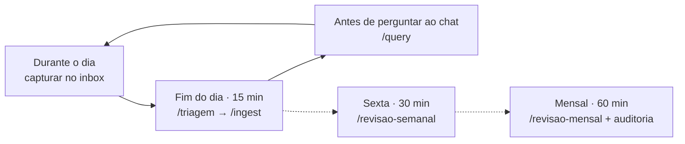

# 03 · Rotina

> **Capturar é instantâneo. Ingerir é deliberado.**

Durante o dia, você só joga coisas no `inbox/`. A triagem e a ingestão acontecem num bloco fixo, com você presente.

---

## A semana



| Quando | Tempo | Comandos |
| --- | --- | --- |
| Ao longo do dia | segundos | Web Clipper, **⌘ S** em PDFs, **⌘ N** para ideias |
| Fim do dia | 15 min | `cd ~/SecondBrain && claude`, depois `/triagem` e `/ingest` |
| Antes de abrir um chat genérico | 2 min | `/query ...` |
| Sexta-feira | 30 min | `/revisao-semanal` |
| Mensal | 60 min | `/revisao-mensal`; confira 5 páginas contra os originais em `raw/` |
| Trimestral | 30 min | Pergunte ao agente o que no `CLAUDE.md` gerou atrito e ajuste |

Ingerindo em lote: rode `/ingest` sem argumento e diga *"um por vez, discussão curta, pergunte só o que for ambíguo"*. No máximo uns 5 por sessão.

---

## O que vale alimentar

Bom conteúdo **traz evidência**, **é fonte original** e **conversa com o que a wiki já tem**.

| Tipo | Vale muito | Vale pouco | Pergunte no ingest |
| --- | --- | --- | --- |
| Papers | Experimento com método, amostra e limitações | Opinião sem dados | *O resultado se aplica fora do cenário testado?* |
| Estudos de caso | Números de antes e depois, inclusive fracassos | "10 dicas para..." | *Que números sustentam a conclusão?* |
| Documentação oficial | A regra original (políticas, especificações) | Posts explicando a regra | *Que decisões registradas isto afeta?* |
| Críticas | Textos que discordam do que você acredita | Polêmica sem argumento | *Quem está mais bem sustentado?* |
| Transcrições | Praticantes explicando decisões | Vídeo de divulgação | *O que é experiência e o que é opinião?* |
| Seus textos | Decisões, post-mortems, artigos, notas de sessão | Rascunho sem tese | *Onde sou sustentado e onde é só opinião?* |
| Repositórios | Implementações de referência | Listas de links | *Que decisões de arquitetura diferem das minhas?* |

**Não vale a pena:** páginas de produto e marketing, notícias sem dados, resumos gerados por IA (ingira a fonte original) e conteúdo que repete o que a wiki já tem.

> [!NOTE]
> Afirmações de fornecedores sobre os próprios resultados entram como `[não verificado]`, com o nome do fornecedor. Quando vários fornecedores citam o mesmo caso com números diferentes, a divergência vai para `## Tensões`.

---

## Como decidir o que entra

Antes de aprovar uma fonte na triagem:

1. Responde a uma pergunta em aberto da wiki ou de um projeto meu?
2. Vou usar isso numa decisão nos próximos meses?
3. Contradiz algo que eu já sei ou acredito?
4. É a fonte original, e não um resumo de outra pessoa?

Não para 1, 2 e 3: fica de fora. De 20 papers lidos para um projeto, normalmente só 3 a 5 merecem entrar.

**Pilha grande?** Peça ajuda ao agente sem ingerir:

```text
Leia o resumo e a conclusão de cada arquivo no inbox/ e ordene do
mais ao menos relevante para as lacunas da wiki. Não mova nada.
```

---

## Medindo se está funcionando

```text
❯ /relevancia 30 dias
```

O relatório mostra, por fonte, quantas páginas ela atualizou, com o que se conectou, se respondeu a alguma lacuna e se a evidência é independente.

| Fontes sobre o mesmo tema | O que esperar |
| --- | --- |
| 2 a 3 | Primeiras conexões e tensões |
| 15 a 20 | O `/query` responde o que nenhuma fonte isolada responde |
| 50 ou mais | Sínteses reaproveitadas e padrões entre domínios |

**Teste dos 30 dias:** pergunte à wiki algo que você não saberia responder sozinho. Se a resposta trouxer uma conexão que você não tinha feito, o sistema está funcionando.

---

## Três hábitos

- **Pergunte primeiro à wiki.** Cada resposta salva vira juro composto.
- **Discuta antes de integrar.** Mesmo que seja uma pergunta só.
- **Uma sessão, uma tarefa.** Abra o agente, faça o trabalho, `/exit`. Sessões muito longas fazem o agente pular passos.
